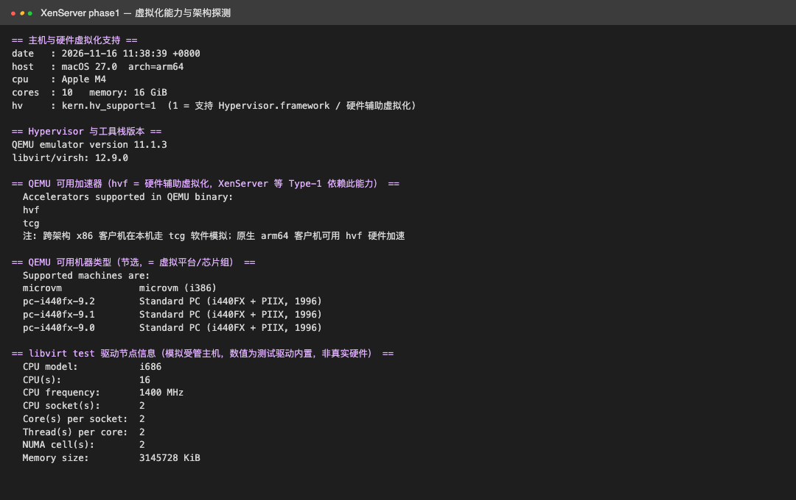

# XenServer Phase 1：虚拟化原理与 XenServer 架构

[方向索引](../README.md) · [源码 lab/](../lab)

## 任务

- 目的：讲清服务器虚拟化的分类与 XenServer 架构，并确认本机的硬件虚拟化能力。
- 方法：梳理 Xen 架构与 XenServer 组件；用 sysctl/QEMU/virsh 探测本机 hypervisor 能力。
- 硬件：本机 CPU；真实 XenServer 需 x86-64 裸机。

## 1. 原理

**虚拟化分类**
- **Type-1（裸机）**：hypervisor 直接跑在硬件上，VM（域）在其上运行。XenServer、VMware ESXi、Microsoft Hyper-V 属此类，性能与隔离好，是服务器虚拟化主流。
- **Type-2（宿主）**：hypervisor 作为普通应用跑在宿主 OS 上，如 VirtualBox、VMware Workstation，适合桌面测试。

**Xen 架构（XenServer 的内核）**
- **Xen Hypervisor**：最小特权层，负责 CPU 调度与内存隔离。
- **dom0（特权域）**：第一个启动的 Linux 域，持有物理设备驱动，通过它管理其他域。
- **domU（客户域）**：普通 VM。
- **XenServer 工具栈**：`xapi`（XAPI 管理服务）+ `xe` CLI / XenCenter / XenOrchestra，提供 VM、SR、网络、池的统一管理。XCP-ng 是其开源分支。

**客户机虚拟化模式**
- **PV（半虚拟化）**：客户机内核知道自己被虚拟化，通过 hypercall 协作，无需硬件虚拟化扩展。
- **HVM（全虚拟化）**：借助 CPU 的 VT-x/AMD-V 完整模拟硬件，可跑未改内核的 OS。
- **PVHVM**：HVM 基础上为磁盘/网络装 PV 驱动（XenServer VM Tools），兼顾兼容与性能，是现代常用模式。

## 2. 本机实验

探测本机硬件虚拟化支持与可用的 hypervisor/工具栈，理解 XenServer 所依赖的底层能力。

```bash
cd lab && ./run_p1_caps.sh
```

要点（原始日志 [`lab/results/p1-caps.log`](../lab/results/p1-caps.log)）：
- `kern.hv_support=1`：本机 CPU 支持硬件辅助虚拟化，这是 Type-1 hypervisor 跑 HVM 客户机的前提。
- QEMU 加速器列出 `hvf`（硬件辅助，对应 XenServer 依赖的 VT-x/AMD-V 类能力）与 `tcg`（软件模拟，跨架构时使用）。
- libvirt test 驱动给出一个“受管主机”视图（节点信息为驱动内置的模拟值，非真实硬件），用于后续阶段演示工具栈操作。



## 3. XenServer 对照

| 本机观察 | XenServer 中的对应 |
| --- | --- |
| `kern.hv_support=1` / `hvf` | 主机 BIOS 开启 VT-x/AMD-V，支持 HVM/PVHVM 客户机 |
| QEMU hypervisor | Xen Hypervisor（Type-1） |
| virsh/libvirt 工具栈 | `xapi` + `xe` CLI / XenCenter |
| 受管主机视图 | 池中的一台 XenServer host（dom0） |

## 4. 未执行（仅方法）

真实 XenServer 需用安装 ISO 在 x86-64 服务器裸机安装 dom0、开启 VT-x/AMD-V、规划管理网卡；本机为 Apple Silicon，无法安装，保留为未执行。
