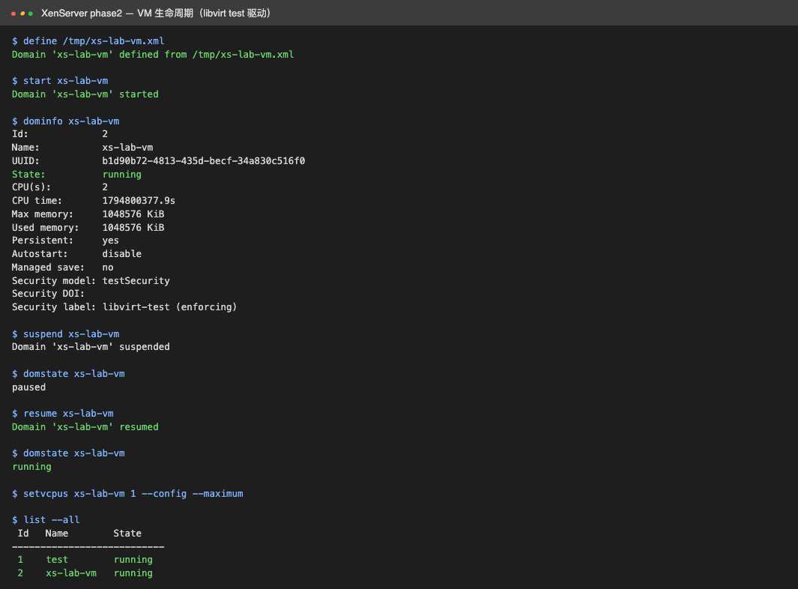

# XenServer Phase 2：主机与 VM 生命周期管理（xe CLI / XAPI）

[方向索引](../README.md) · [源码 lab/](../lab)

## 任务

- 目的：掌握 XAPI 对象模型与 `xe` CLI，完成 VM 的定义、启停、挂起/恢复与参数修改。
- 方法：先讲 `xe` 对象与命令，再用 libvirt test 驱动做等价的生命周期操作。
- 硬件：本机（模拟器）；真实操作需 XenServer 主机。

## 1. XAPI 对象模型与 xe CLI

XenServer 由 `xapi` 服务统一管理，一切皆对象，用 `xe <class>-<action>` 操作：

| 对象 | 含义 | 常用命令 |
| --- | --- | --- |
| host | 物理主机（dom0） | `xe host-list` |
| vm | 虚拟机 | `xe vm-list` / `vm-install` / `vm-start` |
| vbd / vdi | 虚拟块设备 / 虚拟磁盘镜像 | `xe vbd-list` / `vdi-list` |
| vif | 虚拟网卡 | `xe vif-list` |
| sr | 存储库 | `xe sr-list` |
| network | 虚拟网络 | `xe network-list` |
| pool | 资源池 | `xe pool-list` |

典型生命周期命令：
```bash
xe vm-install template="Other install media" new-name-label=xs-lab-vm
xe vm-start    name-label=xs-lab-vm
xe vm-suspend  name-label=xs-lab-vm
xe vm-resume   name-label=xs-lab-vm
xe vm-param-set uuid=<uuid> VCPUs-max=1
xe vm-list
xe vm-shutdown name-label=xs-lab-vm
```

## 2. 本机实验

libvirt test 驱动提供一个纯内存模拟的 hypervisor，可完整演练“定义→启动→挂起→恢复→改 vCPU→列表”的生命周期，与 `xe` 一一对应。所有操作在同一 virsh 会话内完成以保持状态。

```bash
cd lab && ./run_p2_lifecycle.sh
```

原始日志 [`lab/results/p2-lifecycle.log`](../lab/results/p2-lifecycle.log)。



## 3. 命令对照

| 本机实验（virsh，test 驱动） | XenServer（xe CLI） |
| --- | --- |
| `define xs-lab-vm.xml` | `xe vm-install` |
| `start xs-lab-vm` | `xe vm-start` |
| `dominfo` / `domstate` | `xe vm-param-list` / `vm-list params=power-state` |
| `suspend` / `resume` | `xe vm-suspend` / `vm-resume` |
| `setvcpus ... --maximum` | `xe vm-param-set VCPUs-max=` |
| `list --all` | `xe vm-list` |

## 4. 边界说明

libvirt test 驱动是**模拟器**：不真正运行客户机内核，用于演示工具栈语义与对象模型，不代表真实 XenServer 的调度与设备行为。真实环境中还需 VM 模板、SR 上的 VDI、VIF 等关联对象，均在 XenServer 主机上执行。
