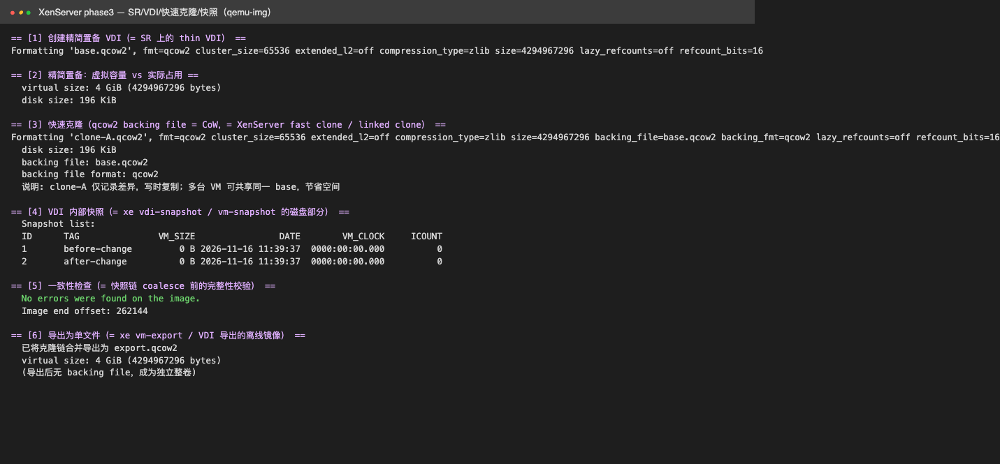

# XenServer Phase 3：存储 SR / VDI / 快速克隆 / 快照 / 精简置备

[方向索引](../README.md) · [源码 lab/](../lab)

## 任务

- 目的：理解 XenServer 存储模型与关键机制：精简置备、写时复制快速克隆、快照、快照链合并。
- 方法：讲 SR/VDI 概念，用 qemu-img 在 qcow2 上复现同样机制并亲自运行。
- 硬件：本机磁盘；真实 SR（iSCSI/NFS/HBA/本地 LVM）需 XenServer 主机。

## 1. XenServer 存储模型

- **SR（Storage Repository）**：存储库，承载 VDI。类型包括 Local LVM、NFS、iSCSI（LVMoISCSI）、HBA、文件型等。
- **VDI（Virtual Disk Image）**：虚拟磁盘，挂到 VM 的 VBD 上。
- **精简置备（thin provisioning）**：VDI 按需分配实际空间，虚拟容量可远大于已用。
- **快速克隆（fast clone）**：基于写时复制（CoW），克隆只记录差异，多 VM 共享同一基镜像。
- **快照（snapshot）**：某时刻的一致点，用于备份或回滚；快照形成链，需定期 **coalesce（合并）** 回收空间。

常用命令：
```bash
xe sr-list
xe vdi-create sr-uuid=<sr> name-label=lab-vdi virtual-size=4GiB type=user
xe vm-snapshot   vm=<vm> new-name-label=snap1
xe vm-clone      vm=<vm> new-name-label=clone1   # 快速克隆（CoW）
xe vm-export     vm=<vm> filename=backup.xva
```

## 2. 本机实验

qcow2 与 XenServer VDI 的机制高度一致：精简置备、backing file（CoW 快速克隆）、内部快照、完整性检查、导出独立镜像。

```bash
cd lab && ./run_p3_storage.sh
```

要点（原始日志 [`lab/results/p3-storage.log`](../lab/results/p3-storage.log)）：
- **精简置备**：`base.qcow2` 虚拟容量 4 GiB，实际占用仅 196 KiB。
- **快速克隆**：`clone-A.qcow2` 以 `base.qcow2` 为 backing file，只记差异（CoW）。
- **快照**：`before-change` / `after-change` 作为内部一致点。
- **完整性检查**：`qemu-img check` 无错误（对应快照链 coalesce 前的校验）。
- **导出**：`convert` 把克隆链合并为无 backing file 的独立整卷。



## 3. 机制对照

| 本机实验（qemu-img / qcow2） | XenServer |
| --- | --- |
| qcow2 文件 | VDI |
| 精简置备（virtual vs disk size） | thin provisioning |
| backing file（CoW） | fast clone / linked clone |
| `qemu-img snapshot` | `xe vm-snapshot` / `vdi-snapshot` |
| `qemu-img check` | 快照链 coalesce 前的一致性 |
| `qemu-img convert` | `xe vm-export`（xva）/ VDI 导出 |

## 4. 未执行（仅方法）

真实 SR 的创建与挂接（iSCSI 发现/登录、NFS 挂载、HBA 扫描、多路径）、以及 GC/coalesce 守护进程行为，需在 XenServer 主机上执行，本机仅以 qcow2 复现文件级机制，保留为未执行。
