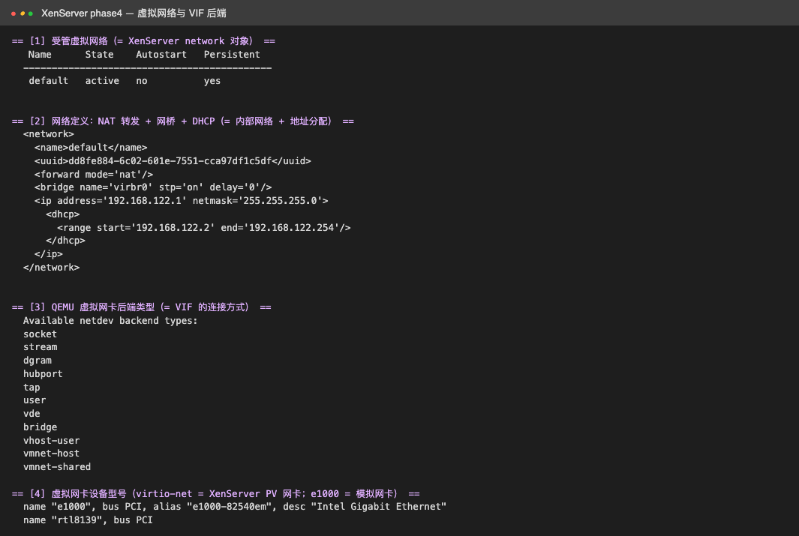

# XenServer Phase 4：网络——虚拟交换、VLAN、绑定

[方向索引](../README.md) · [源码 lab/](../lab)

## 任务

- 目的：理解 XenServer 网络模型（network / PIF / VIF）、VLAN 与网卡绑定，以及虚拟网卡后端类型。
- 方法：讲网络对象，用 libvirt 网络定义与 QEMU 网卡后端枚举演示等价概念。
- 硬件：本机（模拟/枚举）；VLAN、bond、物理上联需真实 NIC 与交换机。

## 1. XenServer 网络模型

- **network**：逻辑虚拟网络，VM 的 VIF 接入其上。
- **PIF（Physical Interface）**：主机物理网卡在 XAPI 中的表示。
- **VIF（Virtual Interface）**：VM 的虚拟网卡，连到某个 network。
- **外部网络**：network 绑定到 PIF，VM 可达物理网络。
- **内部网络**：无 PIF，仅主机内 VM 互通。
- **VLAN**：在 PIF 上划分 802.1Q 标签网络。
- **bonding（绑定）**：多块物理网卡聚合，提供带宽或冗余（active-backup / LACP）。
- **后端**：XenServer 默认用 **Open vSwitch（OVS）** 作为虚拟交换实现。

常用命令：
```bash
xe network-list
xe pif-list
xe vlan-create pif-uuid=<pif> vlan=100 network-uuid=<net>
xe bond-create network-uuid=<net> pif-uuids=<pif1>,<pif2> mode=active-backup
xe vif-create vm-uuid=<vm> network-uuid=<net> device=0
```

## 2. 本机实验

用 libvirt 网络定义展示“NAT 转发 + 网桥 + DHCP”的内部网络结构，用 QEMU 枚举 VIF 的后端连接方式与网卡设备型号。

```bash
cd lab && ./run_p4_network.sh
```

要点（原始日志 [`lab/results/p4-network.log`](../lab/results/p4-network.log)）：
- libvirt `default` 网络：`forward mode='nat'`、网桥 `virbr0`、DHCP 段 `192.168.122.0/24`——对应 XenServer 的一个带地址分配的内部/NAT 网络。
- QEMU netdev 后端（user/tap/bridge/socket 等）对应 VIF 的不同连接方式。
- `virtio-net-pci` 是 PV 网卡（对应 XenServer VM Tools 的 PV 驱动，高性能）；`e1000`/`rtl8139` 是全模拟网卡（HVM 无 PV 驱动时使用）。



## 3. 概念对照

| 本机实验 | XenServer |
| --- | --- |
| libvirt network（virbr0 + NAT + DHCP） | network 对象（内部/外部网络） |
| QEMU netdev（tap/bridge） | VIF 到虚拟交换机的连接 |
| virtio-net-pci | PV 网卡（VM Tools） |
| e1000 / rtl8139 | HVM 模拟网卡 |
| 虚拟交换后端 | Open vSwitch（OVS） |

OVS 的匹配/动作与硬件卸载在本仓库 [DPU 方向](../../DPU/README.md) 另有系统实验，可对照。

## 4. 未执行（仅方法）

VLAN 打标、物理网卡 bonding、PIF 到真实上联、OVS 流表与 SR-IOV 直通，需真实多网卡主机与交换机，本机以 libvirt/QEMU 枚举等价概念，保留为未执行。
