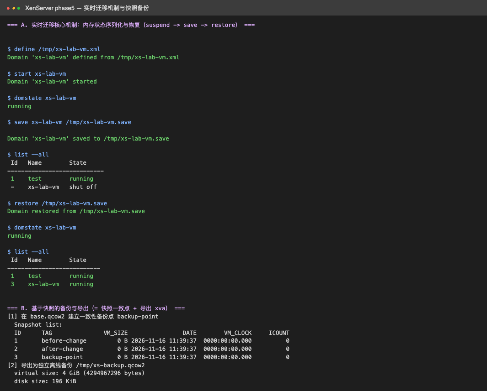

# XenServer Phase 5：XenMotion 实时迁移、HA、资源池、备份

[方向索引](../README.md) · [源码 lab/](../lab)

## 任务

- 目的：理解资源池、XenMotion 实时迁移、HA 与备份的原理与前提条件。
- 方法：讲清机制与依赖，用 virsh save/restore 复现迁移的内存状态序列化核心，用 qemu-img 复现快照备份。
- 硬件：本机（机制演示）；真实迁移/HA 需资源池、两台主机与共享存储。

## 1. 原理

- **资源池（pool）**：多台 XenServer host 组成统一管理域，共享 SR，是 XenMotion 与 HA 的前提。
- **XenMotion（实时迁移）**：在 VM 运行时把它从一台主机迁到另一台。机制是**迭代拷贝内存页**（边运行边复制脏页），收敛后极短暂停、传完最后状态、在目标端恢复，业务几乎不中断。要求共享 SR（磁盘不搬）。
- **Storage XenMotion**：连同 VDI 一起迁移，可跨 SR 甚至无共享存储，代价更高。
- **HA（高可用）**：池内用 **heartbeat SR** 做心跳，主机故障时在其他主机**自动重启**受保护 VM；需防脑裂（fencing）。
- **备份**：`vm-snapshot` 取一致点，`vm-export` 导出 `.xva`；可做计划性快照 + 导出。

常用命令：
```bash
xe vm-migrate   vm=<vm> host=<target-host> live=true          # XenMotion
xe vm-migrate   vm=<vm> remote-master=<ip> ... live=true       # 跨池/存储迁移
xe pool-ha-enable heartbeat-sr-uuids=<sr>
xe vm-snapshot  vm=<vm> new-name-label=daily
xe vm-export    vm=<vm> filename=daily.xva
```

## 2. 本机实验

### A. 实时迁移的核心机制：内存状态序列化与恢复

XenMotion 的本质是把 VM 的内存与设备状态传到目标端再恢复。用 `virsh save`（序列化到文件）+ `restore`（在目标端反序列化恢复）复现这一核心：VM 运行 → save 后变 `shut off`（状态已落地）→ restore 后重新 `running`。跨主机的实时迁移只是把“写文件/读文件”换成“边运行边把内存页通过网络拷到对端”。

### B. 基于快照的备份

在磁盘上建一致性快照点，再导出为独立离线备份镜像（对应 `vm-snapshot` + `vm-export`）。

```bash
cd lab && ./run_p3_storage.sh && ./run_p5_migrate.sh
```

原始日志 [`lab/results/p5-migrate.log`](../lab/results/p5-migrate.log)。



## 3. 机制对照

| 本机实验 | XenServer |
| --- | --- |
| `virsh save`（内存状态序列化到文件） | XenMotion 迭代内存拷贝后的最终暂停点 |
| `virsh restore`（目标端恢复） | 目标主机恢复 VM 执行 |
| save→shut off→restore→running | 源主机暂停、目标主机接管 |
| `qemu-img snapshot` + `convert` | `vm-snapshot` + `vm-export`（xva） |

## 4. 未执行（仅方法）

真实 XenMotion 需要资源池 + 两台物理主机 + 共享 SR，HA 需 heartbeat SR 与 fencing；本机只演示“内存状态序列化—恢复”这一核心机制，跨主机实时迁移、池内 HA 自动重启与脑裂处理保留为未执行，不给出迁移耗时/停机时长等需真实环境测量的结论。
