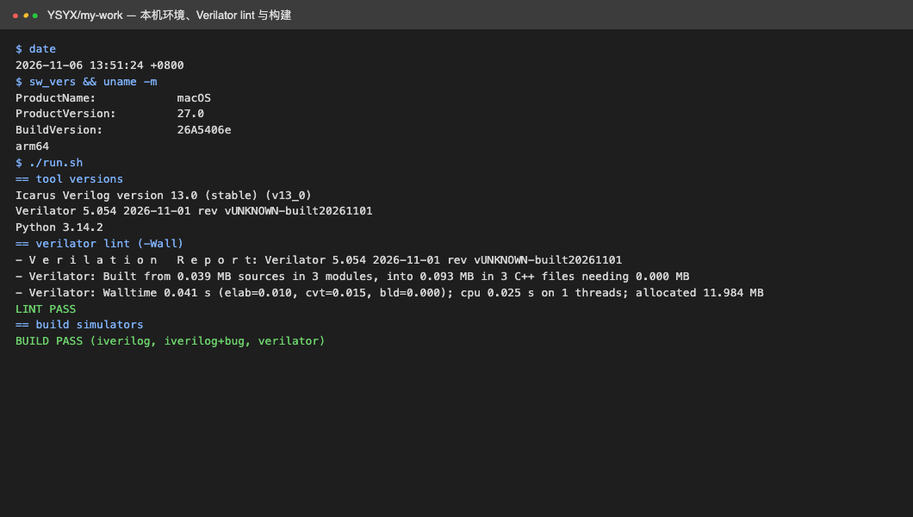
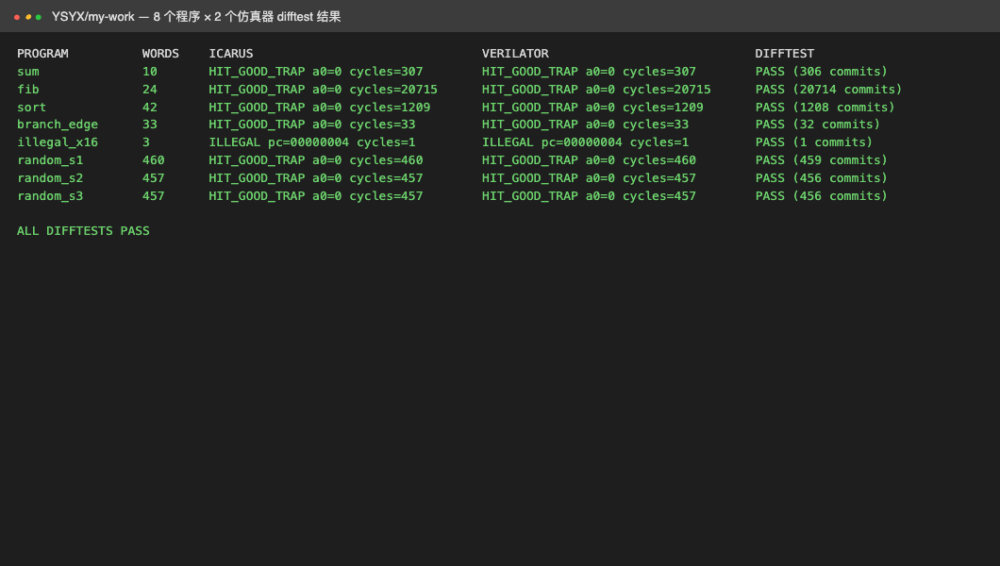
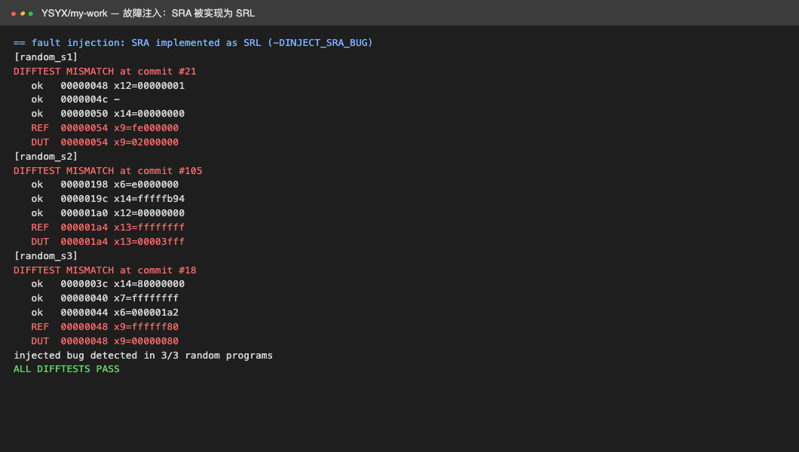
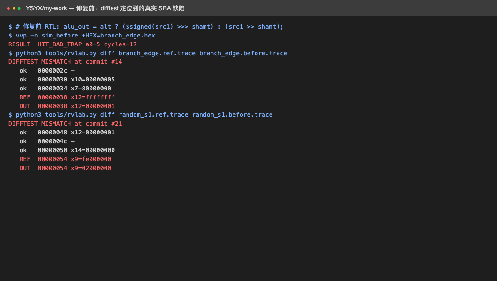

# 一生一芯个人作业：公开成果总结、RV32E 处理器与 difftest 本机验证

[一生一芯栏目](../README.md) · [公开成果索引](../projects/README.md) · [名词与缩写](../../glossary/README.md)

本作业分三部分：一是对[公开成果索引](../projects/README.md)中各作业的横向总结；二是参考其共同方法，独立实现一个 RV32E 单周期处理器及逐指令差分测试（difftest）框架；三是分析本机可执行的范围，并给出实际运行结果与截图。目录中的 RTL、汇编器、参考模型、测试程序和脚本均为本作业独立编写，未复制公开仓库代码。

## 1. 公开作业横向总结

| 维度 | 公开作业中的共同做法 | 差异与不足 |
| --- | --- | --- |
| 微架构路线 | 从单周期/多周期起步，再演进到五级流水线（Y-03）或接入 ysyxSoC 的多周期（Y-04） | 流水线设计说明较完整，但多数未给出相同口径的 IPC 与主频数据 |
| 实现语言 | Verilog/SystemVerilog 为主，也有 Chisel（Y-06） | Chisel 方案依赖 Scala/mill 工具链，复现成本更高 |
| 验证方法 | NEMU 作为参考模型做 difftest，以 AM 程序、游戏和 RT-Thread 做系统级演示（Y-05） | README 多以截图展示，很少给出测试集清单、覆盖范围和失败用例 |
| 性能优化 | 旁路与冒泡取舍、分支计算级、Booth/Wallace 乘法器、Cache（Y-03） | 时序数值缺少工艺库与约束条件；缓存、总线延迟模型简化（Y-04 未实现 axi4delayer） |
| 系统拓展 | 在 NEMU 上启动 Linux（Y-08），调试 TUI（Y-09） | 拓展多基于 NEMU，RTL 侧同等功能的验证证据较少 |
| 工程规范 | Git 提交日志、学号前缀工具（Y-10） | 许可证普遍未声明，限制了复用与引用 |

**总结出的三条结论：**

1. **正确性证据比功能演示更关键。**运行游戏截图只能证明某条执行路径正确；逐指令对照参考模型才能把错误定位到具体 PC 和寄存器。
2. **参考模型必须独立于待测设计。**若参考模型与 RTL 共用同一份译码逻辑，两者会犯同样的错误，difftest 失去意义。
3. **性能数据必须带测量口径。**主频要说明综合工具、工艺库与约束，IPC 要说明测试程序与统计窗口，否则不同作业之间无法比较。

本作业据此确定的重点是：先建立独立参考模型和可重复的 difftest，并用故障注入证明测试能发现错误，再讨论功能扩展。

## 2. 个人作业设计

### 2.1 目标与范围

| 项目 | 内容 |
| --- | --- |
| 任务名称 | RV32E 单周期处理器与三方 difftest |
| 目的 | 掌握 RISC-V 指令编码、处理器数据通路，以及以参考模型为准绳的验证方法 |
| 方法 | 自写 RTL；自写 Python 汇编器与 ISA 参考模型；Icarus Verilog 与 Verilator 双仿真器；提交轨迹逐条比较；故障注入验证测试有效性 |
| 硬件 | 无需 FPGA 或流片，本机 CPU 运行仿真 |
| 方案与原因 | 官方 NEMU/ysyxSoC 环境以 Linux 为主且依赖较重（见第 3 节），因此用轻量的自写参考模型实现与官方 difftest 相同的思想，在 macOS 上即可完整闭环 |

支持的指令：LUI、AUIPC、JAL、JALR、6 种条件分支、LW/SW、9 种立即数运算、10 种寄存器运算、EBREAK（作为停机指令，`a0=0` 表示 HIT GOOD TRAP）。寄存器限于 RV32E 的 x0–x15，访问 x16–x31、非对齐访存或未实现指令均判为 ILLEGAL 并停机。未实现字节/半字访存、CSR、异常与中断。

### 2.2 结构

```text
my-work
├── rtl/ysyx_lab_core.v   单周期 RV32E 核（统一 4 KiB 存储，组合读、同步写）
├── sim/tb.v              测试平台：加载程序、每周期输出提交轨迹、检测停机/非法指令/超时
├── tools/rvlab.py        迷你汇编器 + ISA 参考模型 + 轨迹比较 + 约束随机测试生成
├── tests/*.S             定向测试程序
├── run.sh                一键 lint、构建、运行、difftest 与故障注入
├── results/              运行日志与故障注入差异（逐条轨迹由脚本重新生成，不纳入版本库）
└── screenshots/          本机运行结果截图
```

difftest 的判定对象是**提交轨迹**：每条退休指令记录 `PC` 与 `写回寄存器=值`（无写回记为 `-`），结尾记录停机时的 `a0` 或 ILLEGAL 的 PC。参考模型与两个仿真器各自生成轨迹，逐行比较，首个差异处打印前 3 条已对齐的提交以及 REF/DUT 的不同值。

### 2.3 测试程序

| 程序 | 覆盖内容 | 判定方式 |
| --- | --- | --- |
| `sum.S` | 循环、加法、BNE | 1+…+100 与 5050 比较 |
| `fib.S` | 递归调用、栈帧、JAL/JALR、LW/SW | fib(15)=610 |
| `sort.S` | `la` 取地址、数组访存、有符号比较、含 INT32 最小/最大值 | 冒泡排序后检查非递减 |
| `branch_edge.S` | 有符号/无符号比较、SRAI/SRLI、LUI、AUIPC 与 JAL 偏移 | 每项检查失败返回不同退出码 |
| `illegal_x16.S` | 访问 x16（RV32E 中不存在） | 必须以 ILLEGAL 停机，不得继续执行 |
| `random_s1~s3` | 约束随机生成的 400 条运算/访存指令，含极值初始化 | 固定种子 1、2、3，可重复 |

## 3. 本机可行性分析

本机环境：macOS 27.0、Apple Silicon（arm64）、10 核、16 GiB 内存、磁盘剩余约 22 GiB。

| 内容 | 本机是否可行 | 原因与处理 |
| --- | --- | --- |
| Verilog 仿真与 lint | 可行 | Homebrew 安装 Icarus Verilog 13.0 与 Verilator 5.054，体积小 |
| 自写处理器 + difftest | 可行，已执行 | 本作业主体 |
| 官方 NEMU / AM | 部分可行，未执行 | 依赖 Linux 风格构建环境与 RISC-V 交叉编译器；macOS 需额外移植或使用容器。标准流程见 [未执行项的过程说明](not-executed.md) |
| RISC-V GCC 交叉工具链 | 可行但未安装 | 体积较大且当前磁盘余量有限；本作业以自写汇编器替代，仅支持上述指令子集 |
| ysyxSoC（rocket-chip + mill + JVM） | 不建议 | 依赖重、构建时间长、磁盘占用大；适合在 Linux 服务器上进行 |
| 运行 RT-Thread / Linux | 不可行 | 需要完整 SoC、外设与交叉编译工具链 |
| 综合、时序、物理设计、流片 | 不可行 | 需要工艺库与后端工具；本作业不报告主频与面积 |
| Docker 中的 Linux 环境 | 可作为后续方案 | 本机已安装 Docker，可在容器内运行官方框架，但仍受磁盘余量限制 |

## 4. 本机测试结果

执行命令：

```bash
cd YSYX/my-work
./run.sh
```

完整输出保存在 [`results/run.log`](results/run.log)，执行环境信息见 [`results/env.log`](results/env.log)。

### 4.1 环境、lint 与构建

Verilator `-Wall` lint 无告警（仅屏蔽未使用信号类告警），三个仿真目标构建成功：正常版本的 Icarus 与 Verilator 仿真器，以及注入故障的 Icarus 仿真器。



### 4.2 difftest 结果

8 个程序在两个仿真器上的提交轨迹均与参考模型逐条一致，合计约 2.4 万条提交。`illegal_x16` 在第 2 条指令处按预期以 ILLEGAL 停机。两个仿真器的周期数完全一致。



### 4.3 故障注入：验证测试本身有效

以 `-DINJECT_SRA_BUG` 编译时，RTL 将算术右移错误地实现为逻辑右移。3 个随机程序全部在首条受影响的指令处报告差异，例如 seed 1 在第 21 条提交处，参考值 `fe000000` 与 DUT 值 `02000000` 不一致。这说明 difftest 能检出此类缺陷，并能定位到具体 PC。



### 4.4 开发过程中 difftest 发现的真实缺陷

首次运行时，未注入故障的 RTL 在 `branch_edge` 中返回 `a0=5`（SRAI 检查失败），随机程序也出现与故障注入相同的差异。原因是 Verilog 表达式求值规则：

```verilog
// 修复前：三目运算的另一分支是无符号表达式，整个表达式按无符号求值，>>> 退化为逻辑右移
alu_out = alt ? ($signed(src1) >>> shamt) : (src1 >> shamt);

// 修复后：算术右移在独立的有符号信号中完成
wire signed [31:0] sra_out = $signed(src1) >>> shamt;
alu_out = alt ? sra_out : (src1 >> shamt);
```

Icarus 与 Verilator 对该语义的处理一致，因此只靠两个仿真器互相比较无法发现此问题，必须依靠独立的参考模型。修复前的复现日志见 [`results/bugfix-before.log`](results/bugfix-before.log)。



开发中还发现并修正了两个验证环境自身的问题，同样作为过程记录：

| 问题 | 现象 | 修正 |
| --- | --- | --- |
| 参考模型按固定字段检查寄存器编号 | 分支、存储指令中 `rd` 字段实为立即数，被误判为非法 | 按指令类型判断是否使用 rd/rs1/rs2 |
| 测试平台在时钟上升沿同一时刻释放复位 | Verilator 中第一条指令的提交被漏记，Icarus 正常 | 改为在下降沿释放复位，并在组合逻辑稳定后采样 |

## 5. 思考

1. **difftest 的价值在于定位，不只在于判定。**SRA 缺陷在 `branch_edge` 中仅表现为退出码 5，而逐指令轨迹直接指向 PC `0x38` 的 `x12`，排查时间从读波形缩短到读一行差异。
2. **两个仿真器一致不代表设计正确。**双仿真器可以发现竞争、未初始化等仿真语义问题（本作业的复位时序问题即由此发现），但对语言规则层面的设计错误无能为力。
3. **验证代码同样需要被验证。**参考模型的字段检查错误和测试平台的竞争问题都会产生“假失败”；用故障注入确认测试能失败、用定向测试确认测试能通过，两者缺一不可。
4. **随机测试需要约束与可重复性。**随机程序用极值初始化寄存器并固定种子，SRA 缺陷在 3 个种子下均被触发；若只用小正数初始化，带符号移位缺陷可能长期不暴露。
5. **与官方流程的差距。**本作业的参考模型只覆盖指令子集，没有设备、异常和特权级；进入官方 C/B 阶段时，应换用 NEMU 作为参考模型，并在 Linux 环境下接入 ysyxSoC，同时把轨迹比较扩展为全部寄存器与 CSR 状态比较。

## 6. 限制与后续工作

- 单周期结构，没有流水线、缓存与总线；周期数等于指令数加停机周期，不代表性能。
- 未进行综合，不报告主频、面积与功耗。
- 存储器为仿真模型，非 SRAM 宏单元；未实现字节/半字访存、CSR、异常与中断。
- 后续计划：在 Linux 容器中安装 RISC-V GCC 运行官方 `riscv-tests`；扩展为五级流水线后沿用同一 difftest 框架；接入 NEMU 作为参考模型。

本机未执行的 ysyxSoC 接入、RT-Thread、启动 Linux、逻辑综合与流片，其标准流程、所需环境、关键产物与判定标准见 [未执行项的过程说明](not-executed.md)。
