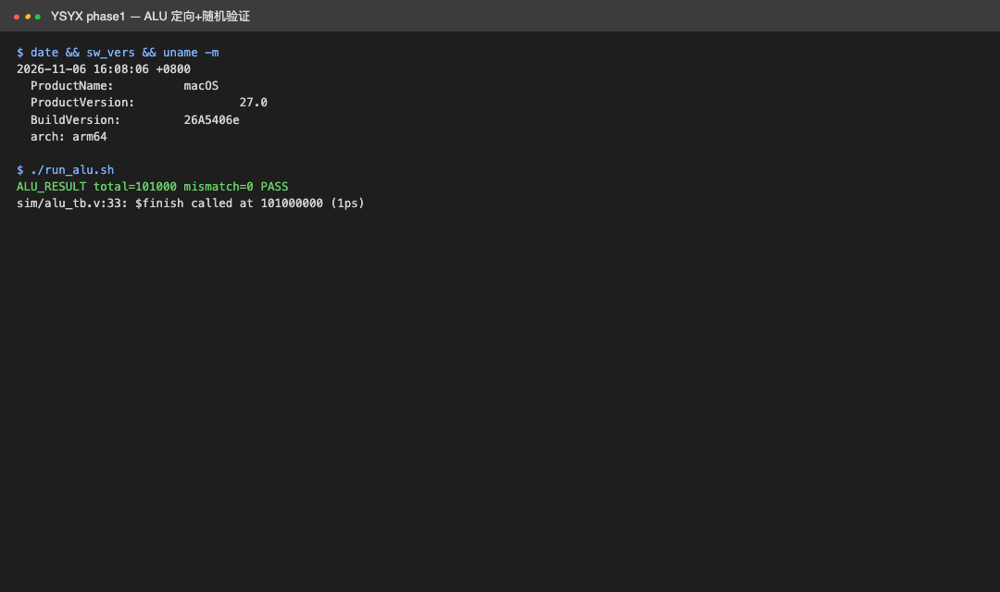

# YSYX Phase 1：ALU 设计与定向/随机验证

[作业索引](../README.md) · [源码 lab/](../lab)

## 任务

实现 RV32E 所需的 32 位 ALU，并用独立参考模型验证其全部运算。

- 目的：在搭处理器之前，先把运算单元做对，建立“RTL 对照独立参考模型”的验证习惯。
- 方法：自写 `ysyx_alu.v`；Python 生成含边界值的向量与期望结果；Icarus Verilog 仿真逐条比对。
- 硬件：本机 CPU，无需 FPGA。

## 实现

- RTL：[`lab/rtl/ysyx_alu.v`](../lab/rtl/ysyx_alu.v)，op 为 `{alt, funct3}` 4 位编码，覆盖 add/sub/sll/slt/sltu/xor/srl/sra/or/and。
- 平台：[`lab/sim/alu_tb.v`](../lab/sim/alu_tb.v)，读 `a b op expected` 向量并统计失配。
- 参考：[`lab/tools/perf.py`](../lab/tools/perf.py) 的 `alu_ref`，与 RTL 独立实现。

向量覆盖 10×10 的边界值全组合（0、±1、`0x7FFFFFFF`、`0x80000000`、`0x55555555`、`0xAAAAAAAA`、移位量 31/32 等）加 10 万条约束随机，共 10.1 万条。移位量取 `b[4:0]`，有符号比较与算术右移按 RISC-V 语义。

## 运行

```bash
cd lab && ./run_alu.sh
```

## 结果

`ALU_RESULT total=101000 mismatch=0 PASS`，原始日志 [`lab/results/alu.log`](../lab/results/alu.log)。



## 结论与遗留

- 边界值全组合能覆盖 Phase 3 中出现的有符号移位类错误；在 ALU 层先排除，可减少处理器层的排查范围。
- 未做门级综合，不涉及时序；进位链、移位结构的时序优化留待后续。
