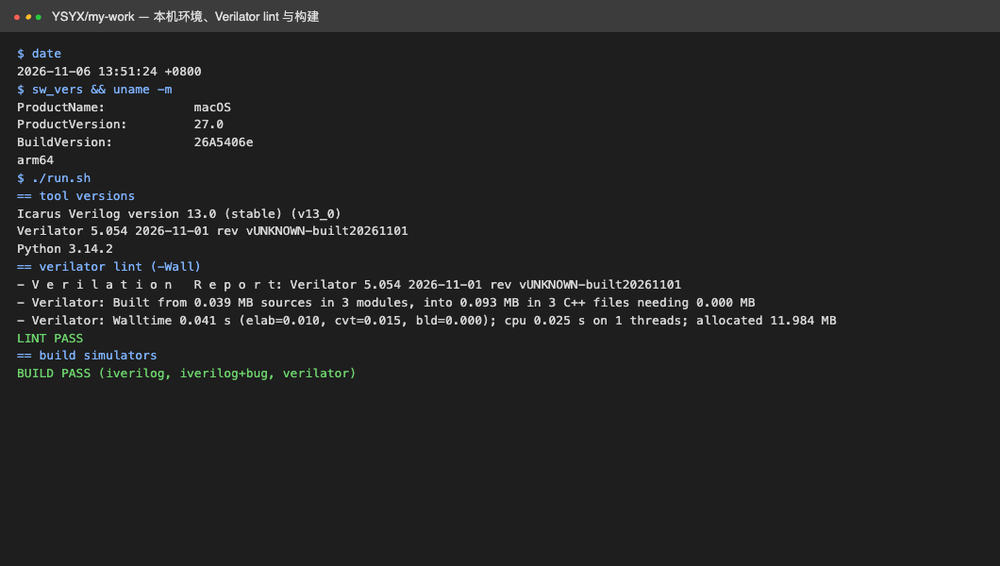
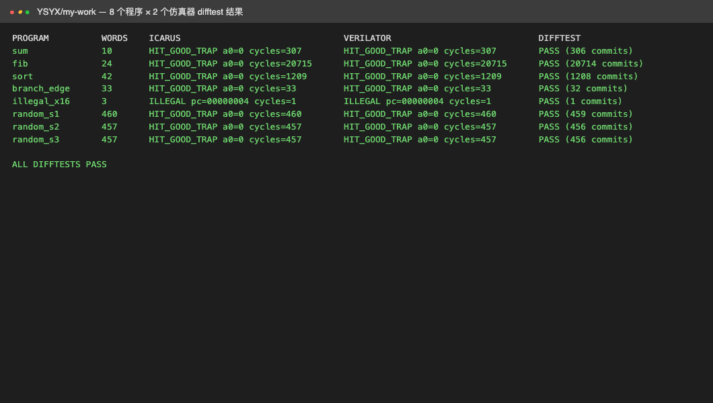

# YSYX Phase 2：单周期 RV32E 核与参考模型 difftest

[作业索引](../README.md) · [源码 lab/](../lab)

## 任务

实现单周期 RV32E 处理器，用独立参考模型对其执行轨迹做逐指令差分测试（difftest）。

- 目的：掌握取指—译码—执行—访存—写回数据通路，以及以参考模型定位错误的验证方法。
- 方法：自写 RTL 核；自写汇编器 + ISA 参考模型；Icarus Verilog 与 Verilator 双仿真器；逐条比对提交轨迹。
- 硬件：本机 CPU。

## 实现

- 核：[`lab/rtl/ysyx_lab_core.v`](../lab/rtl/ysyx_lab_core.v)，寄存器限 x0–x15，支持 LUI/AUIPC/JAL/JALR/分支/LW/SW/立即数与寄存器运算/EBREAK；访问 x16–x31、非对齐访存、未实现指令判为 ILLEGAL 停机。
- 平台：[`lab/sim/tb.v`](../lab/sim/tb.v)，每退休一条指令输出 `PC 写回寄存器=值`，停机输出 `a0`。
- 汇编器与参考模型：[`lab/tools/rvlab.py`](../lab/tools/rvlab.py)。
- 定向程序：[`sum.S`](../lab/tests/sum.S) 求和、[`fib.S`](../lab/tests/fib.S) 递归斐波那契、[`sort.S`](../lab/tests/sort.S) 冒泡排序。

difftest 比较参考模型与两个仿真器的提交轨迹，首个差异处打印前 3 条已对齐提交及 REF/DUT 值。

## 运行

```bash
cd lab && ./run_core.sh
```

## 结果

Verilator `-Wall` lint 无告警，三个仿真目标构建成功。



sum/fib/sort/branch_edge/illegal_x16 与 3 组随机程序，在 Icarus 与 Verilator 上均与参考模型逐指令一致（约 2.4 万条提交），两个仿真器周期数相同；`illegal_x16` 按预期以 ILLEGAL 停机。原始日志 [`lab/results/run.log`](../lab/results/run.log)。



## 结论与遗留

- 功能截图只能证明某条路径正确，逐指令对照才能把错误定位到具体 PC 与寄存器（见 Phase 3）。
- 单周期结构 CPI≈1，不代表性能；流水线留待后续，并沿用同一 difftest 框架。
