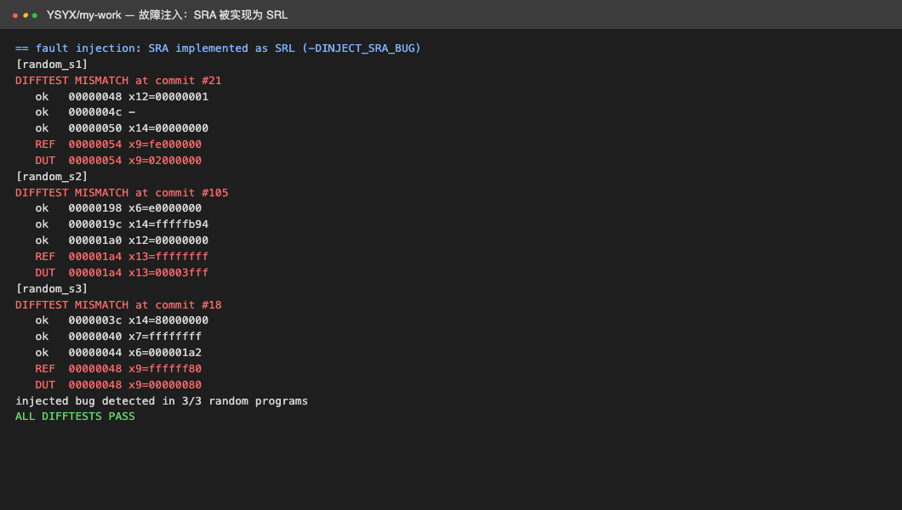
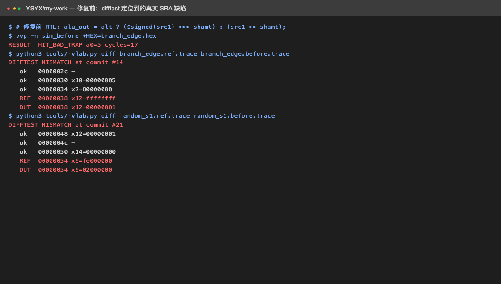

# YSYX Phase 3：边界、约束随机与故障注入

[作业索引](../README.md) · [源码 lab/](../lab)

## 任务

用边界用例、约束随机和故障注入验证 Phase 2 的核，并证明测试本身能发现错误。

- 目的：避免“测试全过”只是因为用例太弱；量化 difftest 的定位能力。
- 方法：定向边界程序 + 固定种子随机程序；用 `-DINJECT_SRA_BUG` 注入缺陷，观察是否被捕获。
- 硬件：本机 CPU。

## 实现

- 边界：[`branch_edge.S`](../lab/tests/branch_edge.S) 覆盖有符号/无符号比较、SRAI/SRLI、LUI、AUIPC 与 JAL 偏移，每项失败返回不同退出码；[`illegal_x16.S`](../lab/tests/illegal_x16.S) 验证访问 x16 必须 ILLEGAL。
- 随机：`rvlab.py random` 以极值初始化寄存器，固定种子 1/2/3，每个 400 条运算/访存。
- 故障注入：在 ALU 的算术右移处注入“SRA 当 SRL”缺陷，重新编译为带缺陷仿真器。

## 运行

```bash
cd lab && ./run_core.sh   # 末尾包含故障注入段
```

## 结果

注入缺陷后，3 组随机程序全部在首条受影响指令处报告差异并定位到具体 PC（如 seed 1 的 commit #21，REF `fe000000` vs DUT `02000000`），即 `injected bug detected in 3/3`。



### 开发中发现的真实缺陷

首次运行时未注入故障的核也在 `branch_edge` 返回 `a0=5`、随机程序出现同类差异。根因是 Verilog 求值规则：

```verilog
// 修复前：三目另一分支为无符号，整体按无符号求值，>>> 退化为逻辑右移
alu_out = alt ? ($signed(src1) >>> shamt) : (src1 >> shamt);
// 修复后：算术右移放入独立有符号信号
wire signed [31:0] sra_out = $signed(src1) >>> shamt;
alu_out = alt ? sra_out : (src1 >> shamt);
```

两个仿真器对该语义一致，只靠双仿真器互比无法发现，必须依赖独立参考模型。复现日志 [`lab/results/bugfix-before.log`](../lab/results/bugfix-before.log)。



另修正两处验证环境自身问题：参考模型按指令类型判断是否使用 rd/rs1/rs2（原按固定字段误判分支/存储为非法）；测试平台改在时钟下降沿释放复位并在组合逻辑稳定后采样（原在上升沿同刻释放导致 Verilator 漏记首条提交）。

## 结论与遗留

- 验证代码也需被验证：用故障注入确认测试能失败，用定向用例确认能通过，两者缺一不可。
- 随机需带约束与可重复性：极值初始化让有符号移位缺陷在 3 个种子下均暴露。
