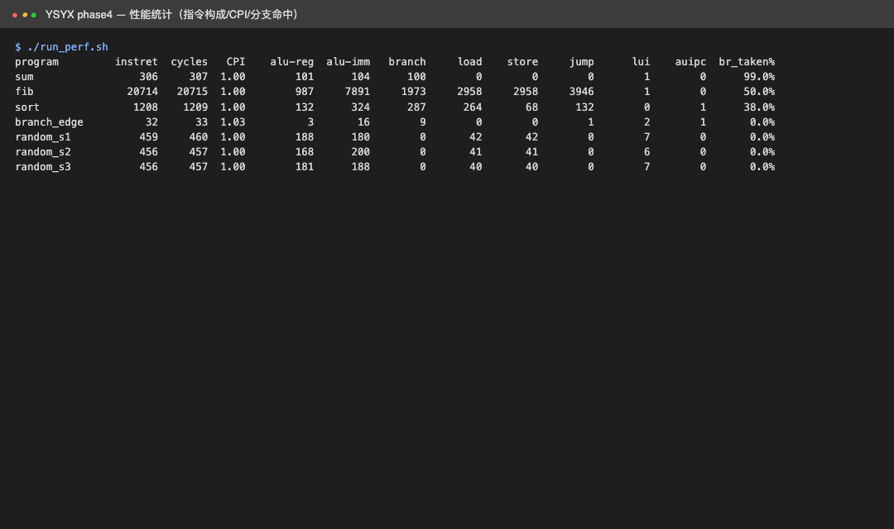

# YSYX Phase 4：指令构成、CPI 与分支命中统计

[作业索引](../README.md) · [源码 lab/](../lab)

## 任务

从已执行程序的轨迹统计指令构成、CPI 与分支命中率，建立带口径的性能画像。

- 目的：练习用可解释的测量口径描述性能，而不是只报一个频率数字。
- 方法：解码每条退休指令的 opcode 归类，统计各类数量、CPI 与分支跳转比例。
- 硬件：本机 CPU。

## 实现

- 分析：[`lab/tools/perf.py`](../lab/tools/perf.py) 的 `report`，读 `build/*.hex` 与 `results/*.ref.trace`。
- 口径：单周期核 `cycles = instret + 1`（含停机周期），故 CPI≈1；分支命中率按下一条退休指令的 PC 是否等于 `PC+4` 判定。

## 运行

```bash
cd lab && ./run_core.sh && ./run_perf.sh
```

## 结果

原始日志 [`lab/results/perf.log`](../lab/results/perf.log)。



要点：
- `sum` 为紧循环，分支命中率 99%（仅末次退出不跳转）。
- `fib` 递归，跳转占比高、命中率约 50%；load/store 成对出现对应栈帧压入/弹出。
- `sort` 冒泡排序分支多、命中率 38%，反映数据相关的提前退出。

## 结论与遗留

- 该 CPI 来自单周期模型，不反映真实流水线性能；要谈性能须先接入流水线并给出时钟来源。
- 下一步：加入流水线与缓存后，用相同程序统计停顿、命中率与 IPC，对照本阶段基线。
- 未做综合，不报告主频、面积与功耗（见 Phase 5）。
